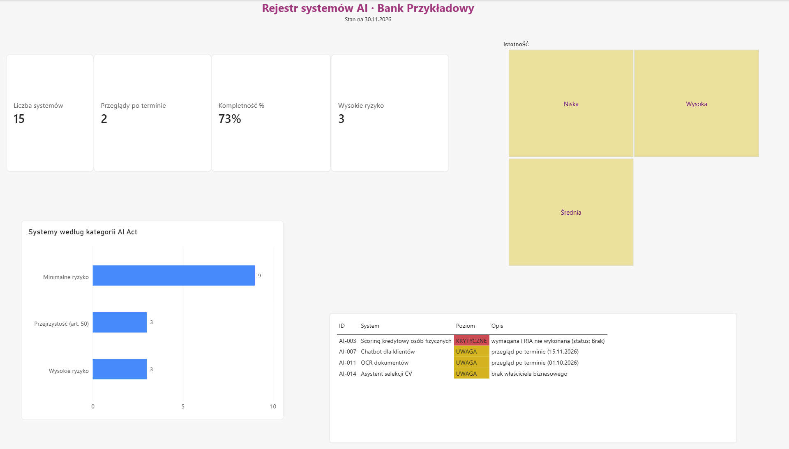

# AI System Register with Triage – a working AI governance prototype

A small but complete model of operational AI governance in a bank: every AI system is triaged, classified under the EU AI Act, recorded in a register with an owner, checked automatically for gaps, and reported to management on a dashboard.

Built on a **fictional bank** ("Bank Przykładowy"). People, vendors and systems are invented. The classification logic is deliberately simplified for demonstration and is not legal advice. Files are in Polish.



## The problem

Banks are expected to know every AI system they use: what it does, who owns it, how risky it is and whether the required assessments are done. In practice, inventories go stale, owners leave, reviews slip and gaps surface only during an audit.

I have run the same problem for 12 years in another regulated field: every waste transfer in my company has to be recorded completely in Poland's national waste registry (BDO). I built a tool that reconciles our records with the registry and flags discrepancies before an inspection does. This project applies that approach to AI systems.

## How it works

```
Triage questionnaire → classification → AI register → completeness checks → dashboard
```

| Layer | What it does | Tool |
| --- | --- | --- |
| Triage | 10 questions about a new AI system; the result (AI Act category, internal materiality, control path) is calculated automatically | Excel |
| Register | 15 AI systems with owner, vendor, lifecycle status, review dates and assessment statuses (FRIA, DPIA, validation) | Excel |
| Rules | Classification steps, materiality scoring, review frequency and control rules K1–K7, all editable in one sheet | Excel |
| Checks | Runs every system through rules K1–K7 and writes a findings report | Python (pandas) |
| Dashboard | Portfolio by risk category, completeness rate, overdue reviews, list of findings, filter by materiality | Power BI |

### Classification logic (simplified)

1. Does the system infer from data (ML, LLM)? If not, it is outside the AI Act scope.
2. Is it a prohibited practice (Art. 5)? If so, stop and escalate.
3. Creditworthiness assessment of natural persons (except fraud detection), life and health insurance pricing, or recruitment (Annex III)? **High risk.**
4. Direct interaction with people (Art. 50)? **Transparency obligations.**
5. Otherwise: **minimal risk.**

Internal materiality (high / medium / low) adds points for influence on decisions about people, personal data and scale of use. Category and materiality together set the control path and the review frequency.

One detail worth noting: recruitment screening is high risk, but the register shows "FRIA required: No" for it. Under Art. 27 a bank must carry out a fundamental rights impact assessment for credit scoring and life or health insurance, not for recruitment tools.

### Control rules

| ID | Rule | Level |
| --- | --- | --- |
| K1 | No business owner | Warning |
| K2 | Missing AI Act category or materiality | Critical |
| K3 | Review overdue | Warning |
| K4 | Required FRIA not completed | Critical |
| K5 | Required DPIA not completed | Critical |
| K6 | Full validation path without completed validation | Critical |
| K7 | Prohibited practice still in use | Critical |

The sample data contains four deliberate gaps. At the control date (30.11.2026) the script finds them and reports 11 of 15 entries complete (73%).

## Repository

```
data/       Rejestr_systemow_AI_Bank_Przykladowy.xlsx   register, triage and rules
scripts/    kontrola_rejestru.py                         completeness checks
output/     braki.csv, status.csv                        latest check results
dashboard/  Rejestr_AI_dashboard.pbix, .pdf              Power BI report
docs/       dashboard.png                                screenshot
```

## Run it

```
pip install pandas openpyxl
python scripts/kontrola_rejestru.py data/Rejestr_systemow_AI_Bank_Przykladowy.xlsx
```

The script prints a summary and writes `braki.csv` (findings) and `status.csv` (one row per system) to the current folder. Refresh the Power BI report to see the new state.

Try it: set the FRIA status of AI-003 to "Wykonana" in the Excel file, run the script and refresh the dashboard. Completeness rises from 73% to 80% and the critical finding disappears.

## What I would add next

- Process diagram of the triage and review cycle (BPMN)
- Reconciliation with other inventories (IT applications, vendor contracts under DORA) to catch unregistered "shadow AI"
- Separate triage paths for generative AI and AI agents

## Framework references

- EU AI Act, Regulation (EU) 2024/1689: Art. 3, 5, 6, 27, 50 and Annex III; application dates as amended by Regulation (EU) 2026/1744 (Digital Omnibus on AI), with Annex III systems from 2 December 2027
- NIST AI Risk Management Framework, ISO/IEC 42001 (concepts of inventory, risk assessment and lifecycle controls)

---

Łukasz Kita · [LinkedIn](https://www.linkedin.com/in/%C5%82ukasz-kita-8338543a0) · [GitHub](https://github.com/lukaskita-ctrl)
